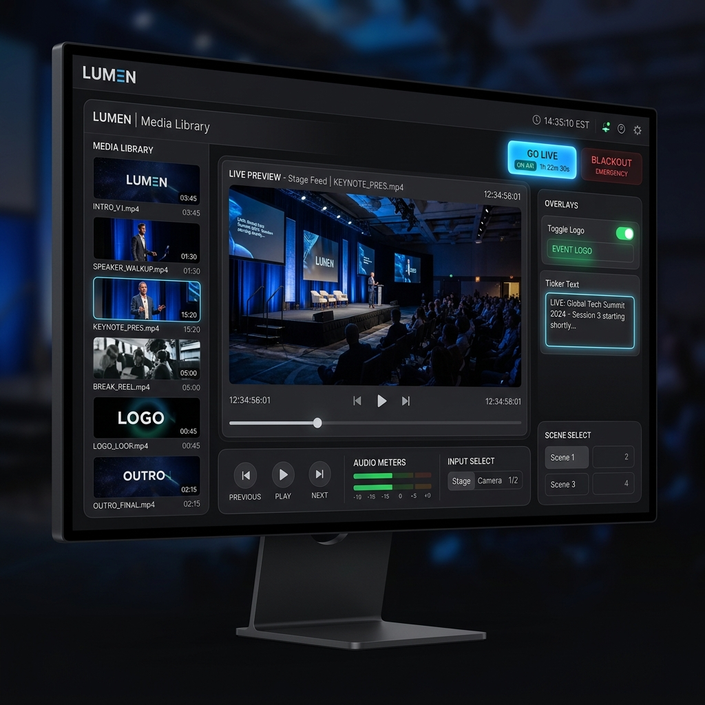

# LUMEN — Pro Event Media Controller



LUMEN là phần mềm điều phối truyền thông chuyên nghiệp dành cho các sự kiện, được xây dựng trên nền tảng Electron. Với giao diện tối giản, sang trọng và các tính năng được tối ưu hóa cho người vận hành (Operator), LUMEN giúp bạn quản lý hình ảnh và video trên sân khấu một cách mượt mà nhất.

## 🚀 Tính năng nổi bật

- **Giao diện Premium (Glassmorphism):** Thiết kế hiện đại, dễ nhìn trong môi trường thiếu sáng của các phòng kỹ thuật.
- **Dual Layer Rendering (Layer A/B):** Cơ chế chuyển cảnh mượt mà trong 0.8 giây, loại bỏ hiện tượng đen màn hình khi đổi clip.
- **Heartbeat Synchronization:** Đồng bộ hóa thời gian thực giữa Dashboard và Stage, đảm bảo độ trễ gần như bằng không.
- **TV Simulation (16:9):** Khung xem trước được khóa ở tỷ lệ vàng của Tivi để phản ánh chính xác đầu ra.
- **Branding & Overlays:** Tích hợp sẵn Logo sự kiện và Ticker (chữ chạy) có thể cập nhật nội dung tức thì.
- **Persistence Media Library:** Tự động lưu trữ danh sách media, không bị mất dữ liệu khi khởi động lại ứng dụng.
- **RAM Optimization:** Tự động giải phóng bộ nhớ khi đổi media, đảm bảo vận hành ổn định cho các show kéo dài.

## ⌨️ Hệ thống Phím tắt (Hotkeys)

- **SPACE:** Kích hoạt lệnh **GO LIVE** (Phát nội dung đã chọn).
- **ESC:** Kích hoạt lệnh **BLACKOUT** (Toàn màn hình đen khẩn cấp).
- **Phím F:** Phím tắt cho **FREEZE** (Tạm dừng/Tiếp tục video).

## 🛠️ Cài đặt & Chạy ứng dụng

1. **Yêu cầu:** Đã cài đặt [Node.js](https://nodejs.org/).
2. **Cài đặt thư viện:**
   ```bash
   npm install
   ```
3. **Khởi chạy:**
   ```bash
   npm start
   ```

## 📂 Cấu trúc dự án

- `src/main`: Chứa logic quản lý cửa sổ và IPC Communication.
- `src/renderer/operator`: Giao diện điều khiển dành cho Kỹ thuật viên.
- `src/renderer/stage`: Giao diện đầu ra dành cho màn hình Tivi/Máy chiếu.

---
© 2026 LUMEN Project by **ggviet**. Developed for high-stakes event coordination.
